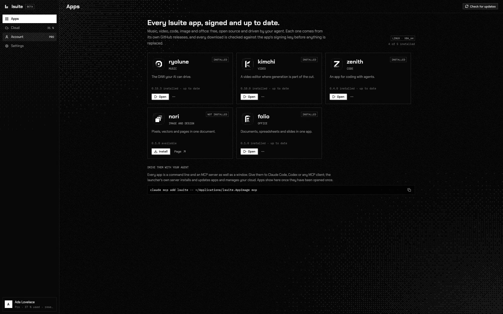

# lsuite

Free, open-source apps for video, music, images and documents, each one drivable end to end by
your AI agent.

**Status:** Beta · v0.3.0 · Linux and macOS

<picture>
  <source media="(prefers-color-scheme: light)" srcset="assets/img/launcher/apps-light.webp">
  
</picture>

## What it is

lsuite is a suite of four native desktop apps, written in Rust and released under the MIT
licence. There are no accounts, no plans and nothing to buy. In every app, everything you can
click is also a named command, so you, a script or an AI agent (through the built-in agent
panel, a CLI or an MCP server) work on the same document with the same undo history.

| App | For | Version | Source |
| --- | --- | --- | --- |
| [kimchi](https://lsuite.xyz/kimchi) | video editing, motion graphics and generative video | 0.12.0 | [ludovic111/kimchi](https://github.com/ludovic111/kimchi) |
| [ryolune](https://lsuite.xyz/ryolune) | music production (a DAW) | 0.17.0 | [ludovic111/ryolune](https://github.com/ludovic111/ryolune) |
| [nori](https://lsuite.xyz/nori) | images, vector drawings and page layout | 0.3.0 | [ludovic111/nori](https://github.com/ludovic111/nori) |
| [folio](https://lsuite.xyz/folio) | documents, spreadsheets and slides | 0.3.0 | [ludovic111/folio](https://github.com/ludovic111/folio) |

This repository holds what the four apps share:

- **The launcher** (`launcher/`, v0.3.0): a native app, also called lsuite, that installs, updates,
  opens and removes the apps from their signed builds, lists the plugins installed for each one,
  and asks an app's agent to build a new plugin. It has its own CLI (`lsuite-cli`) and MCP server
  (`lsuite-mcp`).
- **The site**, [lsuite.xyz](https://lsuite.xyz): a page per app, the launcher's downloads, and
  the public routes the launcher and the apps' updaters use to fetch builds.
- **The design system** (`design/`): the tokens, components and rules every app and the site
  follow, with a live preview at [lsuite.xyz/design](https://lsuite.xyz/design).
- **The standard** every app meets ([STANDARD.md](STANDARD.md)), with a status table per app.

## Getting it

Download the launcher from [lsuite.xyz/launcher](https://lsuite.xyz/launcher), or from the
latest `launcher-v*` [release](https://github.com/ludovic111/lsuite/releases):

| System | File |
| --- | --- |
| Linux (x86-64) | `lsuite-linux-x86_64.AppImage` or `lsuite-linux-x86_64.tar.gz` |
| macOS, Apple silicon | `lsuite-macos-arm64.dmg` |
| macOS, Intel | `lsuite-macos-x86_64.dmg` |
| Windows | Coming soon |

The macOS builds are signed with a Developer ID and notarized by Apple. Open the launcher and
install any of the four apps; it keeps them up to date and checks every download against the
app's signing key before anything is replaced. Each app's source is in its own repository, so
you can also build it yourself.

## Usage

The site is plain HTML, CSS and JavaScript served by a dependency-free Node server. It needs
Node 22 or later:

```bash
npm run dev     # http://localhost:4321
npm test
```

Without `LSUITE_BUILDS_TOKEN` the pages still render, but the build routes answer 503 (see
[DISTRIBUTION.md](DISTRIBUTION.md)).

The launcher is a separate Rust workspace (Rust and GPUI):

```bash
cd launcher
cargo run -p lsuite                      # the window
cargo run -p lsuite-cli -- apps.list     # any command, from a terminal
cargo test --workspace
```

## Documentation

- [docs/site.md](docs/site.md): the site's files, routes and domains, and how an app's page is updated
- [launcher/README.md](launcher/README.md): the launcher, its commands, environment and releases
- [design/DESIGN.md](design/DESIGN.md): the design system
- [STANDARD.md](STANDARD.md): the contract every lsuite app meets, and where each one stands
- [PLUGINS.md](PLUGINS.md): plugins in every app, and how an agent builds one
- [HARNESS.md](HARNESS.md): the agent harness each app ships
- [DISTRIBUTION.md](DISTRIBUTION.md): how the apps' builds are published and served
- [launcher/CHANGELOG.md](launcher/CHANGELOG.md): what changed in each launcher release

## Project status and roadmap

lsuite is in beta. The launcher and all four apps are released for Linux (x86-64) and macOS
(Apple silicon and Intel). Known limits:

- **Windows is not built yet.** Its code paths stay in the source, but no Windows builds are made
  or shipped; the site says "coming soon".
- **Ready-made builds come only through the launcher.** The apps' signed builds are served by
  lsuite.xyz from a private build repository; their source stays public in each app's repository.
- **The agent harness and its evaluations are partial** in every app: only some evaluation jobs
  have been run so far (see the status table in [STANDARD.md](STANDARD.md)).
- App-specific limits are listed in each app's README and release notes.

Next: Windows builds, and closing each app's remaining gaps against the standard.

## Contributing

Bug reports and suggestions are welcome as GitHub issues. Report problems with an app in that
app's repository; use this one for the launcher, the site and the design system. Before opening
a pull request, run `npm test` for the site and `cargo test --workspace` in `launcher/`.

## Licence

[MIT](LICENSE). The bundled fonts (Chakra Petch, IBM Plex Mono) are under the SIL Open Font
License, and the Lucide icons under the ISC licence. Logos of other services are the trademarks of
their owners ([assets/img/logos/SOURCES.md](assets/img/logos/SOURCES.md)); image credits are in
[assets/img/SOURCES.md](assets/img/SOURCES.md).

---

Made by [Ludovic Marie](https://lu4ovic.com) · [GitHub](https://github.com/ludovic111)
